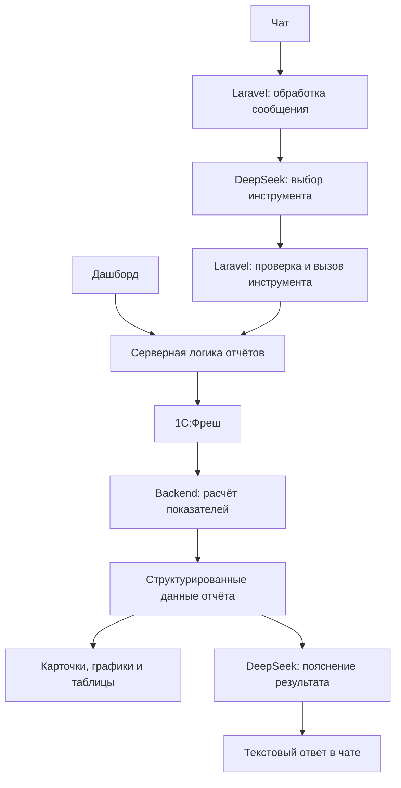

# Osminog

**Бизнес-аналитика из 1С:Фреш: ключевые показатели на дашборде и ответы на вопросы в чате.**

Osminog помогает руководителю быстро посмотреть статистику компании и разобраться в цифрах без ручного поиска по отчётам. Дашборд предназначен для регулярного просмотра показателей, а чат — для запросов на обычном языке: «Покажи топ-5 наших должников» или «Какой НДС за октябрь?».

> Проект находится на стадии фронтенд-прототипа. Графики используют демонстрационные данные, чат отвечает заготовленными сообщениями. Подключение к 1С:Фреш, Laravel и DeepSeek пока не реализовано.

## Что уже работает

- **Дашборд:** динамика выручки по месяцам, топ-5 должников и карточки итоговых сумм.
- **Фильтр периода:** выручка за 3 или 6 месяцев. Задолженность показывается на отдельную дату среза.
- **Детализация:** таблицы с теми же данными, что используются в графиках.
- **Демосостояния:** загрузка, отсутствие данных, ошибка и повторный запрос.
- **Чат:** интерфейс диалога с отправкой сообщений и демонстрационными ответами.
- **Адаптивный интерфейс:** мобильная версия, анимации графиков и карточек, учёт настройки уменьшения движения.

Все компании и финансовые показатели в прототипе вымышлены. Остальные разделы бокового меню пока представлены заглушками.

## Как будет работать продукт

### Дашборд

Пользователь открывает экран и выбирает период. Фронтенд запрашивает готовые показатели у backend и отображает карточки, графики и таблицы. Для обычного просмотра статистики обращение к ИИ не требуется.

### Чат

Пользователь задаёт вопрос. ИИ выбирает подходящий инструмент отчётности, backend получает данные из 1С и рассчитывает показатели. В ответе пользователь видит данные отчёта и текстовое пояснение.

Планируемая схема:



Дашборд и чат будут использовать общую серверную логику отчётов. При одинаковых фильтрах и одном срезе данных показатели должны совпадать.

### Принципы интеграции

- Числа, проценты и сравнения рассчитывает backend; ИИ формулирует пояснения по готовым результатам.
- Данные таблиц и графиков передаются фронтенду отдельно от текста ИИ.
- Backend проверяет параметры инструментов и доступ пользователя к организации.
- Учётные данные 1С хранятся на сервере в зашифрованном виде и не передаются модели или браузеру.
- Доступность OData, состав регистров и правила расчёта нужно проверить на конкретной базе 1С до подключения реальных отчётов.
- Неоднозначный запрос требует уточнения: например, вся задолженность или только просроченная, на какую дату и по какой организации.

Это целевая архитектура, а не описание уже работающего backend.

## Технологии

| Область | Используется сейчас |
| --- | --- |
| Интерфейс | React 18, TypeScript 6 |
| Сборка | Vite 8 |
| Стили | Tailwind CSS 4, CSS рядом с представлениями |
| Графики | Chart.js, react-chartjs-2 |
| Анимации | Motion |
| Иконки | Lucide React |
| Качество кода | ESLint, typescript-eslint, React Hooks и Fast Refresh |

**Планируемые интеграции:** Laravel, 1С:Фреш через доступные интерфейсы OData, DeepSeek API с вызовом инструментов.

## Локальный запуск

Понадобятся Node.js 24+, npm, Python 3 и shell, совместимый с `sh`. Python используется скриптом выбора локальных портов.

```bash
git clone https://github.com/whithmeee/dashbord1c.git
cd dashbord1c
npm ci --prefix frontend
```

При первом запуске создайте локальную конфигурацию портов, затем запустите фронтенд:

```bash
test -f infrastructure/.env || sh infrastructure/scripts/setup-ports.sh
sh infrastructure/scripts/run-frontend.sh
```

Откройте адрес, который Vite выведет в терминале, и выберите **«Дашборды»** или **«Чат»** в боковом меню. Для остановки сервера нажмите `Ctrl+C`.

Порты хранятся в `infrastructure/.env`, который не попадает в Git. Для демонстрационной версии backend, база данных и API-ключи не нужны.

## Проверки и сборка

Выполняйте команды из папки `frontend/`:

| Команда | Назначение |
| --- | --- |
| `npm run lint` | Проверка ESLint; предупреждения тоже приводят к ошибке команды |
| `npm run lint:fix` | Автоматическое исправление поддерживаемых нарушений |
| `npm run build` | Проверка TypeScript и сборка в `frontend/dist/` |

ESLint проверяет типичные ошибки JavaScript и TypeScript, использование хуков и их зависимостей, совместимость экспортов с Fast Refresh, строгие сравнения и импорты типов. Конфигурация — [frontend/eslint.config.js](frontend/eslint.config.js).

Автоматизированный тестовый набор пока не подключён к npm-командам проекта.

## Структура проекта

```text
frontend/
├── src/
│   ├── features/navigation/       Боковое меню и навигация
│   ├── modules/chat/              Интерфейс чата
│   └── modules/dashboard/
│       ├── dashboard.tsx          Сборка зависимостей модуля
│       ├── domain/                Модели отчётов и результатов
│       ├── application/           Use case загрузки отчёта
│       ├── adapters/demo/         Демоисточник и тестовые данные
│       └── presentation/
│           ├── page/              Страница, контроллер и состояние
│           ├── reports/           Карточки и таблицы
│           └── charts/            Графики и настройки Chart.js
└── eslint.config.js
infrastructure/scripts/            Локальный запуск и настройка портов
ProductSpecification/              Проектные спецификации
.claude/                           Общие инструкции и навыки AI-агентов
```

В дашборде запрос проходит от представления через контроллер и use case к источнику данных. Результат возвращается в состояние контроллера и отображается компонентами. Стили расположены рядом с соответствующими представлениями.

Демоисточник подключается в [dashboard.tsx](frontend/src/modules/dashboard/dashboard.tsx). Будущий API-адаптер можно будет подключить в этой точке, сохранив компоненты графиков и отчётов.

## Ближайшие шаги

- Подключить backend и заменить демонстрационные данные ответами API.
- Добавить авторизацию, выбор организации и подключение к 1С:Фреш.
- Проверить источники данных и согласовать правила расчёта отчётов.
- Подключить DeepSeek и разрешённые инструменты отчётности.
- Отображать графики и таблицы в ответах чата.
- Добавить отчёт по НДС после согласования показателей.
- Подключить автоматизированные тесты основных пользовательских сценариев.

## Разработка с AI-агентами

В `ProductSpecification/technology.md` пока сохранён исходный профиль шаблона со Spring. Он не описывает реализованный backend продукта: серверная часть ещё не добавлена, а Laravel указан здесь как планируемый стек.

## Лицензия

В репозитории сохранена [MIT License](LICENSE). Сведения об авторстве исходного шаблона приведены в файле лицензии.
